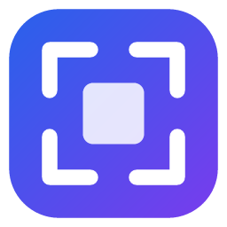

<div align="center">



# Recorte

A snipping tool in the tray.<br>
For Windows and macOS; Linux next.

<sub><i>recorte</i>: Portuguese for <i>clipping</i>, a piece cut out</sub>

**[josebarbosa.dev/recorte](https://josebarbosa.dev/recorte/)**

</div>

Press **Win+Shift+S**, drag across any part of the screen, and it's on the
clipboard. A small editor opens with it for a pen, a highlighter, arrows,
boxes and blur, then copy it again or save it. It's the same keys as
Windows' own Snipping Tool, but faster to come up and with better markup.

It's one file of under 1 MB with nothing else to install. Idle in the tray,
it uses a few MB of memory and no CPU.

## Taking a snip

- **Win+Shift+S**, a left click on the tray icon, **New snip** in its menu,
  or launching Recorte again while it's running all freeze the screen and dim
  it. **Snip in 5 seconds** waits first, for a menu or a hover state.
- Drag across what you want. When you let go it's on the clipboard, as an
  image any app can paste.
- **Enter** without dragging takes the whole monitor. **Esc** or a right
  click cancels.

Recorte takes Win+Shift+S over from Windows: while Recorte is running, the key
opens Recorte and not Snipping Tool. Quit Recorte and Windows has it back.

## Recording the screen

- **Win+Shift+R**, or **New recording** in the tray menu, freezes the screen
  the same way. Drag across the area to record, or **Enter** for the whole
  monitor.
- A thin dashed frame goes around the area, and a small bar at the top of
  the screen. Nothing is filmed yet, so there's time to get the screen ready.
- **Win+Shift+R** again, or the red button, starts it and the frame turns
  red. Once more, or the stop button, stops it, and the video is saved to
  `Videos\Screen Recordings\Recorte 2026-10-28 14-03-11.mp4` and opens.
- While it films, the first button is a pause. What happens until you press
  it again is left out of the video.
- The microphone and the speaker on the bar say what sound is in the video:
  your voice, what the computer plays, both or neither. They can be changed
  while it films, and the next recording starts the way you left them.
- The cross on the bar closes it. Once it films, the cross is a bin that
  throws the video away, and asks for a second click before it does.
- The bar can be dragged out of the way by its clock.

While you're choosing, a small menu at the top of the screen shows a camera
and a film camera: click one, or press the other hotkey, to change between a
snip and a recording of what you select next.

The video is H.264 in an MP4 at 30 frames a second, with the mouse pointer
and an AAC sound track. The frame and the bar aren't in it. Win+Shift+R is taken
over from Snipping Tool like Win+Shift+S.

## The editor

| | tool | key |
|---|---|---|
| pen | freehand | P |
| highlighter | wide, see-through, like ink on paper | H |
| arrow | | A |
| box | | R |
| blur | pixelates what's under it, for an email address or a token | B |

Pick a colour (keys 1 to 6) and a size (the dot, or **[** and **]**). Each
tool remembers its own colour, so the highlighter stays yellow.

**Ctrl+Z** undo, **Ctrl+Y** redo, **Ctrl+C** copy, **Ctrl+S** save,
**Ctrl+N** a new snip, **Esc** close. Copy and save show a tick when they're
done. Saving suggests `Pictures\Screenshots\Recorte 2026-10-28 14-03-11.png`.

## On a Mac

Snipping works the same, with **Ctrl+Shift+S** (macOS keeps Cmd+Shift+3
to 5 for its own screenshots). The icon is in the menu bar, not the Dock.

- The first snip asks for the **Screen Recording** permission. Allow it in
  System Settings > Privacy & Security > Screen & System Audio Recording,
  then quit Recorte and start it again: macOS applies it only to a fresh
  start. Without it macOS shows the wallpaper and no windows.
- A snip is on the clipboard as PNG and TIFF, and saved to
  `~/Pictures/Screenshots`.
- Recording the screen isn't there yet on a Mac; Ctrl+Shift+R selects an
  area, but filming it says so.
- Settings and the log are in `~/Library/Application Support/Recorte`.

## Settings

**Edit settings** in the menu opens `%APPDATA%\Recorte\config.json`. Changes
apply within two seconds, the hotkeys included.

| setting | default | |
|---|---|---|
| `hotkey` | `Win+Shift+S` | Ctrl, Alt, Shift, Win, plus a letter, digit, F1-F24 or PrintScreen |
| `recordHotkey` | `Win+Shift+R` | the same, for recording |
| `copyOnSnip` | `true` | copy the moment the snip is taken |
| `openEditor` | `true` | open the editor with each snip |
| `autoSave` | `true` | also save every snip, as taken |
| `saveFolder` | `""` | where to save; empty is `Pictures\Screenshots` |
| `recordFolder` | `""` | where recordings go; empty is `Videos\Screen Recordings` |
| `openRecording` | `true` | open each recording in your video player when it's done |
| `recordMic` | `false` | the microphone is in a recording; the bar's button changes it |
| `recordSystemAudio` | `true` | the same for what the computer plays |

The menu also has **Start at login**, **Open screenshots folder**,
**Open recordings folder** and **Open log** (`%APPDATA%\Recorte\recorte.log`; `RECORTE_LOG=debug` for more).

## Building

```powershell
.\build.ps1                    # tests, release exe and installer, into dist\
.\build.ps1 -Icons -Run        # ... also redraw the icons and docs\img, then launch
cargo build --release          # just target\release\recorte.exe
recorte --dump-icons assets    # redraw assets\icon.ico and the PNGs
recorte --render-docs          # redraw docs\img: the site's icons and editor pictures
```

`dist\` gets the portable `recorte-<version>-x64.exe`, `Recorte-Setup-<version>.exe`
and a `Recorte-Setup.exe` copy, the name the download link uses. The installer
needs [Inno Setup](https://jrsoftware.org/isinfo.php) (`winget install
JRSoftware.InnoSetup`); without it the script still builds the exe.

On a Mac, `build.sh` makes the app:

```sh
./build.sh                     # tests, release binary and dist/Recorte.app
./build.sh --dmg               # ... and dist/Recorte-<version>.dmg
./build.sh --install           # ... also copy it to /Applications and open it
./build.sh --universal         # one binary for Apple silicon and Intel
SIGN_IDENTITY="Developer ID Application: ..." ./build.sh
```

Without `SIGN_IDENTITY` the app is signed ad hoc, and macOS asks for the
Screen Recording permission again after each rebuild.

The shared tray-app pieces (log, single instance, autostart, config, theme)
come from [traykit](https://github.com/kidchenko/traykit). To build against a
local checkout next to this one, see traykit's README.

## How it works

The overlay and the editor are plain pixel buffers drawn with tiny-skia and
shown with softbuffer: no webview, no GPU, and the same drawing code on
every system. The screen is captured once, with GDI, before the overlay goes
up, so you select on a still picture, menus and tooltips included. The
hotkeys are a low-level keyboard hook, the only way to have Win+Shift+S and
Win+Shift+R, which Windows registers for itself.

A recording is the same GDI capture, of the area only, thirty times a second,
encoded by Windows' own Media Foundation, on the graphics card when it has
an encoder. The sound is the default microphone and a loopback of the
default speakers, from WASAPI, mixed into one track. So there's still
nothing to install and no codec in the binary.

## License

MIT
